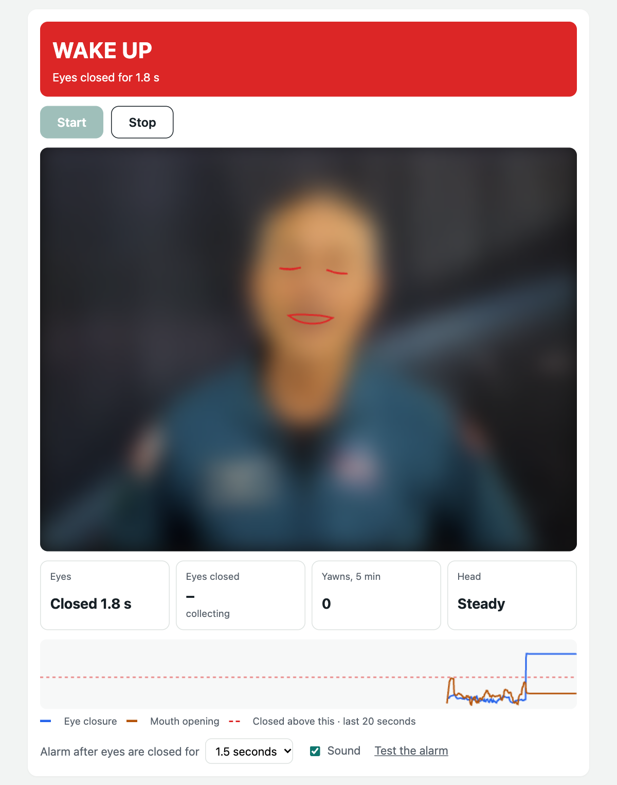

# Driver drowsiness detection: live demo

**Try it:** https://finalcommitprojects.github.io/demo-drowsiness/

Watches your eyes, yawns and head through the camera, and sounds an alarm if you nod off. A sample project, not a safety device.

This repository only hosts the live demo, so the JavaScript here is bundled and minified. The full source code, with the setup or training scripts, tests, documentation and the project report, comes with the project when you take it with [Final Commit](https://finalcommitprojects.github.io/?utm_source=github&utm_campaign=demo-drowsiness).

Uses MediaPipe Face Landmarker (Apache 2.0), loaded from jsDelivr. The camera image in the screenshot is blurred.

© 2026 Final Commit. All rights reserved.
